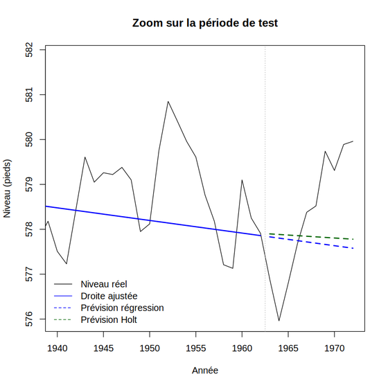
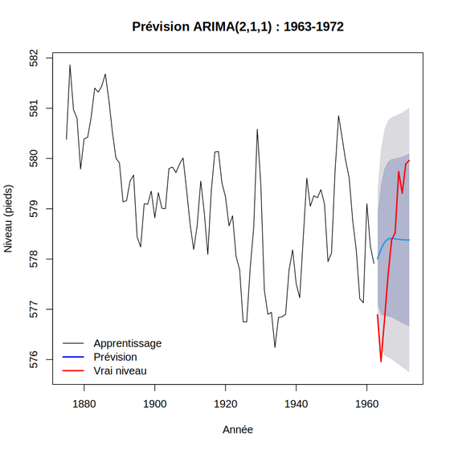

# Prévision du niveau du lac Huron — Séries temporelles

Modéliser l'évolution du niveau annuel du lac Huron (1875–1972) et prévoir les années futures, en comparant des modèles simples (lissage de Holt, régression linéaire) à des modèles **ARIMA** construits selon la **méthode de Box-Jenkins**.

**Résultats clés sur les 10 dernières années (1963–1972, jamais vues par les modèles) :**
* **Meilleur modèle :** ARIMA(2,1,1), avec un **RMSE de 1,29 pied**
* **13 % d'erreur en moins** que le lissage de Holt et **17 % de moins** que la régression linéaire
* **Résidus = bruit blanc** (test de Ljung-Box : p = 0,86) : le modèle a capté la structure de la série

[Consulter le notebook complet](LacHuron_prevision_series_temporelles.ipynb)

---

## Contexte

* **Problématique :** prévision d'une série temporelle univariée.
* **Données :** série `LakeHuron` fournie avec R : **98 mesures annuelles** du niveau du lac, en pieds (1 pied ≈ 30 cm).
* **Spécificité :** contrairement à des observations indépendantes, **l'ordre compte**. Les années ne sont jamais mélangées, et les modèles sont toujours évalués sur **les dernières années**.

## Méthodologie (Box-Jenkins)

1. **Stationnarité :** test de Dickey-Fuller augmenté (ADF). La série brute n'est **pas stationnaire** (p = 0,25).
2. **Différenciation :** une seule différenciation suffit (ADF : p < 0,01), donc **d = 1**.
3. **Identification :** autocorrélogrammes simple et partiel (ACF, PACF) de la série différenciée, qui orientent vers de petits modèles.
4. **Découpage :** apprentissage 1875–1962, test 1963–1972.
5. **Modèles de référence :** lissage exponentiel de Holt et régression linéaire sur le temps.
6. **Estimation et sélection :** ajustement de tous les ARIMA(p, 1, q) pour p, q de 0 à 3, comparés par **AIC / BIC**.
7. **Validation :** significativité des coefficients et analyse des résidus (test de **Ljung-Box**).
8. **Prévision et comparaison :** **RMSE** sur la période de test.

## Résultats

### Les modèles de référence ne suffisent pas

La régression linéaire et le lissage de Holt prolongent une **légère baisse** et ne suivent pas les mouvements du niveau. Les résidus de la régression restent **fortement autocorrélés** (Ljung-Box : p ≈ 10⁻¹⁵) : il reste de l'information que le modèle n'exploite pas.

### Prévision du modèle ARIMA(2,1,1)

Le modèle ARIMA prévoit une **légère remontée** du niveau, dans la bonne direction. Le vrai niveau reste globalement dans les **intervalles de confiance**, qui s'élargissent avec l'horizon de prévision.

### Comparaison des erreurs de prévision

| Modèle | AIC | RMSE (pieds) |
| :--- | :---: | :---: |
| **ARIMA(2,1,1)** | 189,88 | **1,29** |
| ARIMA(1,1,2) | 189,29 | 1,30 |
| Lissage de Holt | — | 1,48 |
| Régression linéaire | — | 1,56 |

Les deux meilleurs ARIMA sont presque équivalents (AIC et RMSE très proches). L'ARIMA(2,1,1) est retenu pour sa meilleure prévision, avec des coefficients significatifs et des résidus de type bruit blanc.

## Limites et pistes d'amélioration

* **Peu de données de test** (10 ans) : les résultats dépendent de l'endroit où l'on coupe la série.
* **Événement extrême :** la période de test contient le minimum historique de 1964, qu'aucun modèle fondé sur le seul passé ne pouvait anticiper.
* **Pas de variables explicatives :** le niveau d'un lac dépend des précipitations, de l'évaporation et des débits. Un modèle **ARMAX** intégrant ces variables serait plus solide.

## Stack technique

`R` · `tseries` · `forecast` · `Google Colab`

---
*Projet réalisé par Ndeye Maimouna Badiane — Élève ingénieure en Mathématiques Appliquées et Modélisation (Polytech Lyon), dans le cadre du cours de séries temporelles.*
